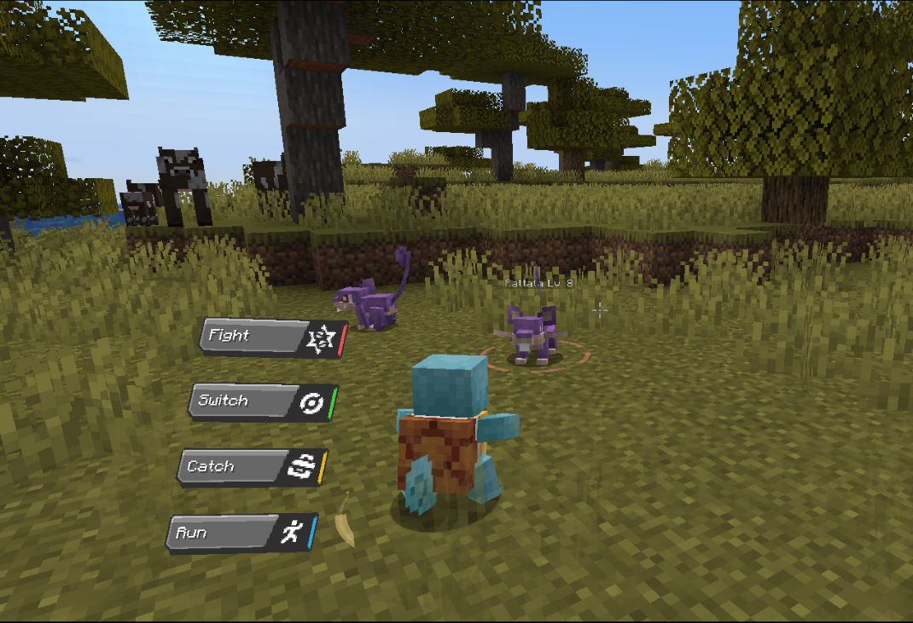
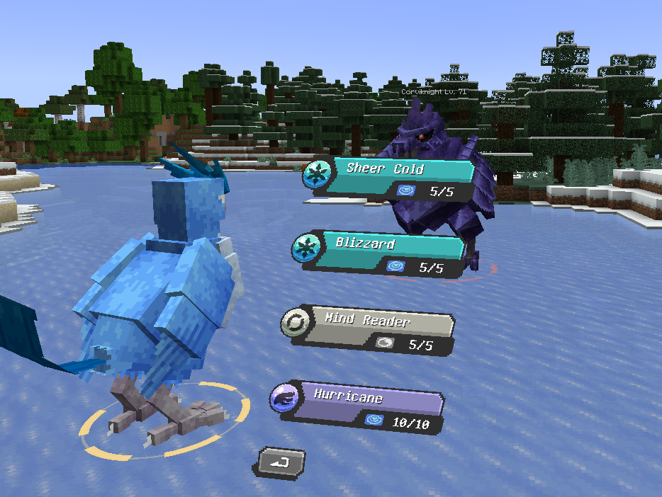
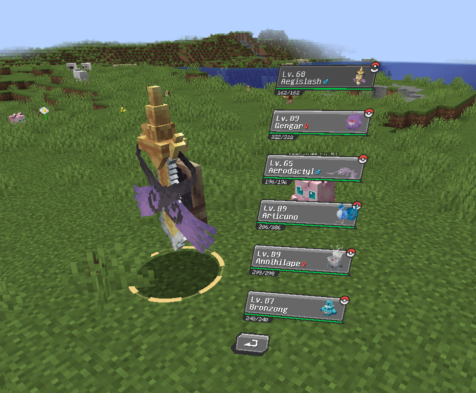

# CBPR (Cobble Battle Preview Rehaul)

A client-side Fabric mod that gives Cobblemon battles a cinematic camera and a floating battle menu.

CBPR (Cobble Battle Preview Rehaul) frames a battle like a cutscene and floats Cobblemon's own battle menu beside your Pokémon. It changes only what you see and hear. The battle itself is untouched, and no server install is needed.







## Features

- Cinematic camera: an opening wide shot, an over-the-shoulder command view, a push-in when the menu opens, and shots for attacks, faints, send-outs, switches, victory, captures, weather changes and Mega Evolution, Terastallization, Z-Power, Ultra Burst and Dynamax.
- Floating menu: Cobblemon's own moves, party and mega showdown buttons, moved beside your Pokémon.
- Presentation: letterbox bars, move callouts, impact stamps, floating damage numbers, an opponent title card and ground ring, status and low-health cues, a weather and terrain vignette.
- Formats: singles, doubles and triples.
- Reduced Motion setting for the interface, and a master switch that gives Cobblemon's normal battle view.

## Requirements

| | Version |
|---|---|
| Minecraft | 1.21.1 |
| Java | 21 or newer |
| Fabric Loader | 0.17.2 or newer |
| Fabric API | any |
| Fabric Language Kotlin | any |
| Cobblemon | 1.8.2 or newer |

[Mod Menu](https://modrinth.com/mod/modmenu) is optional. It adds a settings button.

## Compatible mods

[Mega Showdown](https://github.com/yajatkaul/CobblemonMegaShowdown)

## Usage

Start a Cobblemon battle. CBPR takes over the camera when the battle begins and hands it back when it ends.

Open the settings screen with the chat command:

```
/cbpr config
```

or with the Mod Menu button. The top button turns CBPR on or off. Settings are stored in `config/cbpr.json`.

## Status

Under active development.

## License

[MIT](LICENSE)
